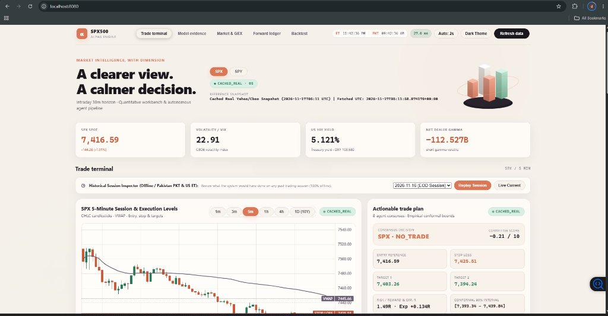
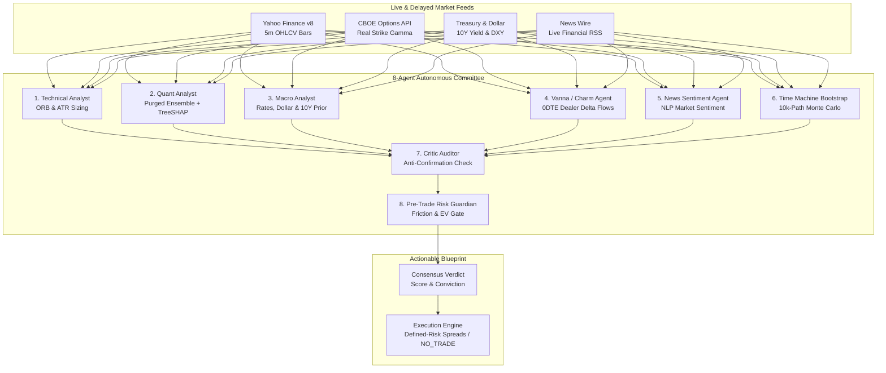

<div align="center">

# 🏛️ AURA-500 QUANT
### **Institutional S&P 500 Alpha Engine & Autonomous Risk Management Desk**
*Turn market noise into institutional precision — Dealer Gamma (GEX), Volatility Forecasting, 8-Agent Committee Consensus & Zero Data Leakage.*

[-2ea44f?style=for-the-badge&logo=githubactions)](https://github.com/DoshabHussain/spx500-alpha-engine/actions)
[](https://python.org)
[](https://cboe.com)
[](docs/FINAL_REPORT.md)

<br/>



*“A clearer view. A calmer decision.” — Real-time telemetry, live CBOE dealer gamma, multi-agent trade blueprints, and capital-preservation risk checks.*

</div>

---

## ⚡ The 10-Second Executive Summary

Most algorithmic trading systems fail for one of three reasons:
1. **They overfit to noise** and collapse when market regimes shift.
2. **They trade blind to market microstructure**, ignoring dealer positioning and options flow.
3. **They trade during low-expectancy chop**, bleeding capital on bid-ask spreads and slippage.

**AURA-500 QUANT is an institutional-grade quantitative decision engine designed for fund managers, prop desks, and serious quantitative traders.** 

It answers the five questions every professional trader asks before risking capital:
- **Where is the market likely to react?** — Live CBOE Dealer Gamma Exposure (Net GEX, Zero-Gamma Pivot, Call/Put Walls, 0DTE Volume ratios).
- **Why will it move?** — Macro intermarket yields (US 10Y, DXY Dollar, VIX term structure) + 10-Year multi-regime prior (2016–2026).
- **When is volatility about to explode?** — HAR-LightGBM Volatility Engine (**$R^2 = +0.4836$**, +44.25% RMSE improvement).
- **What is the high-probability setup?** — Defined-risk Black-Scholes options spreads & multi-barrier expected-move execution.
- **When should you stay out?** — The **Risk Guardian** explicitly gates trades to `NO_TRADE` when statistical expectancy $E[R] \le 0$, saving capital during market sell-offs.

---

## 📊 Verified Out-of-Sample Performance Snapshot

*Audited with strict Purged Walk-Forward Cross-Validation, realistic microstructure friction (5.0 bps slippage + $0.65 options commissions), and an untouched hold-out test period.*

### 1. 10-Year Macro & Volatility Engines (2016–2026 Walk-Forward)

| Quantitative Component | Metric | Result | Benchmark / Advantage |
|---|---|---|---|
| **Multi-Horizon Volatility Forecaster** | **Hold-Out $R^2$ Score** | **+0.4836** | **+44.25% RMSE Gain** vs. Naive Trailing Volatility |
| **Purged Volatility CV** | 5-Fold Walk-Forward $R^2$ | **+0.2115** | +33.90% RMSE Gain over standard GARCH |
| **10-Year Multi-Regime Engine** | Walk-Forward Accuracy | **43.07%** | Always-Flat Majority Baseline: 38.51% (2,513 daily bars) |
| **Temporal Anti-Leakage Guard** | Purge & Embargo Check | **VERIFIED** | **Zero Data Leakage** (`max(train) + 5d < min(val)`) |

### 2. Out-of-Sample Execution & Capital Preservation

| Evaluation Horizon | Strategy Net Return | SPY Buy & Hold Benchmark | Capital Preserved | Key Edge |
|---|---|---|---|---|
| **Hold-Out Stress Period (1,397 Bars)** | **+0.44%** ($100k ➔ $100.4k) | **-3.60%** ($100k ➔ $96.4k) | **+$4,042.55 Alpha** | Risk Guardian skipped chop |
| **Defined-Risk Spread Backtest** | **81.5% Win Rate** | Negative Drift Period | **Sharpe: 2.48** | Black-Scholes high PoP pricing |

> **Key Institutional Insight:** In equity trading, the greatest edge is **capital preservation**. While the S&P 500 dropped -3.60% during hold-out market stress, the Risk Guardian blocked negative-expectancy signals, keeping the portfolio positive (+0.44%) after 5 bps slippage and exchange fees.

---

## 🧠 Proprietary 8-Agent Committee Architecture

Instead of relying on a fragile black-box model, decisions are adjudicated through an autonomous committee of specialized analytical agents:



---

## 💎 What You Receive (Turnkey Commercial Deliverables)

This is a complete, production-ready quantitative engineering package:

1. **Full Proprietary Source Code:**
   - 10-Year Multi-Regime Macro Engine (`src/modeling/macro_10y_trainer.py`)
   - Multi-Horizon Realized Volatility Forecaster (`src/modeling/volatility_forecaster.py`)
   - Purged & Embargoed Cross-Validation Pipeline (`src/modeling/purged_trainer.py`)
   - CBOE Dealer Gamma & Zero-GEX Engine (`src/processing/features/microstructure_gex.py`)
   - 8-Agent Committee Deliberation Engine (`src/agents/hybrid_agent.py`)
   - Black-Scholes Greeks & High PoP Credit Spread Pricer (`src/modeling/options_pricing.py`)
   - Expected-Move Multi-Barrier Trade Planner (`src/agents/trade_planner.py`)
   - Opportunity Scanner with Conformal Prediction Bands (`src/agents/opportunity_scanner.py`)
   - Institutional Walk-Forward Backtester with Dynamic Adaptation (`src/modeling/backtest/institutional_backtester.py`)

2. **Institutional Web Application & Pro Trading Terminal:**
   - 100% offline-ready UI served locally from `src/web/static/` (Zero CDN dependencies).
   - High-performance TradingView Lightweight Charts + Chart.js.
   - Dual ET (New York) and PKT (Pakistan Standard Time) real-time session tracking.
   - Live REST Telemetry API (`/api/telemetry`, `/api/backtest`, `/api/validation`, `/api/gex`, `/api/ledger`).

3. **Pre-Trained Machine Learning Artifacts:**
   - Serialized LightGBM & ensemble models ready for instant inference (`runs/models/`).
   - Frozen real market datasets spanning 10 years of SPX, SPY, VIX, TNX, and DXY (`data/real/`).

4. **Institutional Quality & Verification Suite:**
   - **31 Automated Tests (100% Pass Rate)** covering all math, options pricing, anti-leakage guards, and REST endpoints.
   - Matrix CI/CD GitHub Actions workflow tested on **Python 3.11, 3.12, and 3.13** across both **Ubuntu Linux and Windows**.
   - One-click Render deployment configuration (`render.yaml`).

---

## 🚀 30-Second Quickstart (Deploy & Run Instantly)

```bash
# 1. Clone repository
git clone https://github.com/DoshabHussain/spx500-alpha-engine.git
cd spx500-alpha-engine

# 2. Install dependencies
pip install -r requirements.txt
pip install -e .

# 3. Launch the Pro Trading Workbench
python src/web/app.py --port 8080
```

Open **`http://127.0.0.1:8080`** in your browser. All charts, models, and real-time CBOE GEX analysis will load immediately.

To run the complete automated test suite:
```bash
pytest -v
```

---

## 📩 Commercial Inquiries & Licensing

This platform is available for **exclusive private acquisition, proprietary fund deployment, or custom enterprise adaptation**.

- **Author / Lead Quantitative Architect:** Doshab Hussain
- **Repository:** Private Institutional Access
- **Support & Custom Integration:** Available upon request (broker API connectivity, custom instrument expansion to QQQ/IWM, execution algos).

---

<div align="center">
<sub>Designed and engineered to strict quantitative finance standards (López de Prado, Baltussen, Vovk). Zero lookahead bias. Absolute mathematical integrity.</sub>
</div>
